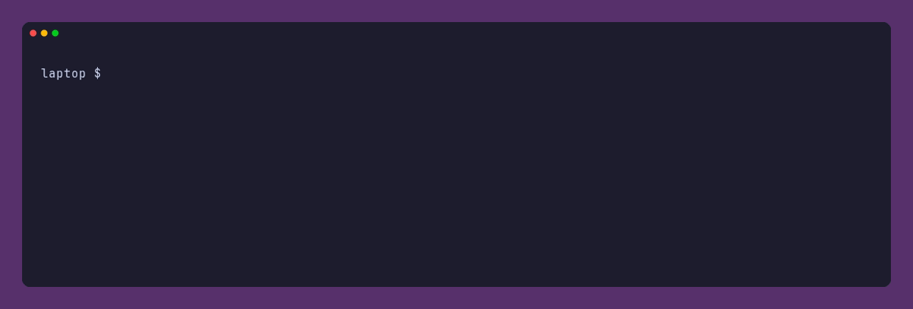
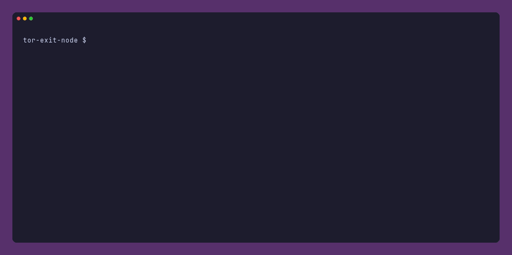
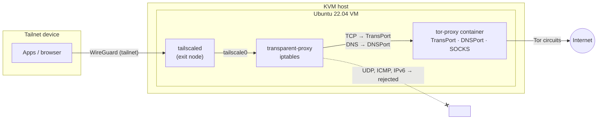
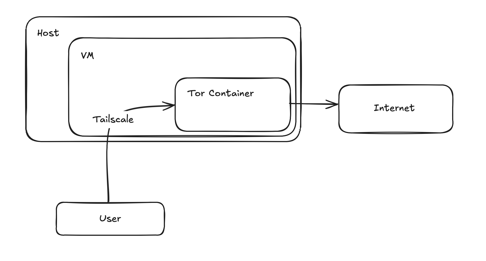
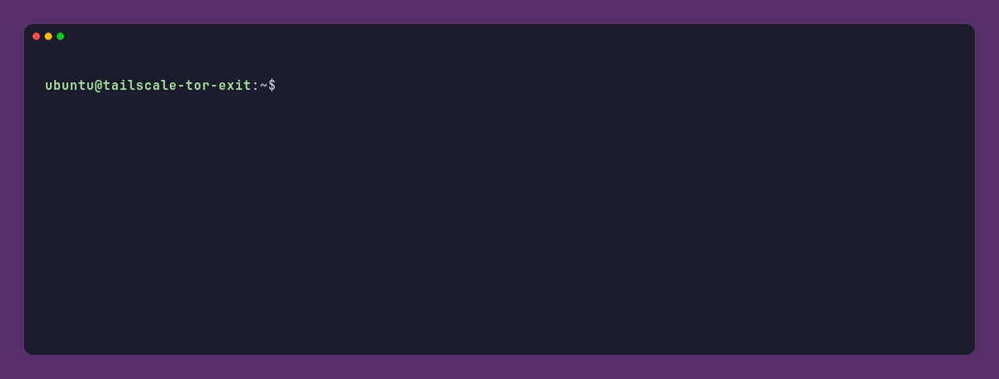

<div align="center">

# Tailscale Tor Exit Node

**Send any device in your tailnet through Tor with one tap. No Tor Browser, no proxy settings.**

[](LICENSE)
[](terraform/)
[](ansible/)
[](https://www.torproject.org)
[](https://tailscale.com/kb/1103/exit-nodes)



</div>

Pick this machine as the exit node on a laptop, phone or tablet, and that device's TCP traffic and DNS leave the internet from a Tor exit. One command provisions a hardened Ubuntu VM on a KVM host, runs Tor in a locked-down container, and installs a transparent-proxy firewall that **fails closed**: if Tor is down, traffic stops. It never falls back to your real IP.

## Highlights

- **Transparent.** Every app on the device uses Tor, including ones with no proxy support.
- **Leak-resistant.** Client TCP goes to Tor's TransPort and all DNS to its DNSPort. UDP, ICMP and IPv6 are rejected instead of forwarded.
- **Fails closed.** A stopped or broken Tor means no traffic and no DNS, never cleartext.
- **Self-healing.** A watchdog restarts a stalled Tor and restores firewall rules. Repairs take the node offline first.
- **Hardened.** Key-only SSH, UFW, fail2ban, automatic security updates. Tor runs non-root with a read-only filesystem and no capabilities.
- **One command, verifiable.** `make deploy` builds everything; `make verify` proves it, from bootstrap to leak checks.

## Quick start

**You need:** a Linux x86_64 host with KVM and libvirt, Terraform, Ansible, and a [Tailscale auth key](https://login.tailscale.com/admin/settings/keys). See [Requirements](#requirements).

```bash
git clone https://github.com/metharda/tor-exit-node.git
cd tor-exit-node
make check-deps   # confirms the host is ready
make deploy       # asks for VM settings and the auth key, then builds everything
```

<div align="center">

<br><sub>A real deployment, played back 10× faster. It took about 5½ minutes on the test host.</sub>
</div>

`make deploy` creates the VM with Terraform, configures it with Ansible, and finishes with the health and leak check. Then:

1. **Approve the exit node** in the [Tailscale admin console](https://login.tailscale.com/admin/machines): open the machine's **⋯** menu, choose *Edit route settings*, and tick *Use as exit node*. To approve automatically, see [operations.md](docs/operations.md#approving-and-sharing-the-exit-node).
2. **Use it** from any device, through the exit-node menu in the Tailscale app or the CLI:

   ```bash
   tailscale set --exit-node=tailscale-tor-exit
   curl https://check.torproject.org/api/ip    # {"IsTor":true,"IP":"<a Tor exit>"}
   ```

3. **Stop using it:** `tailscale set --exit-node=`

> [!IMPORTANT]
> Keep **Use Tailscale DNS** enabled on your devices. It is on by default; the CLI equivalent is `tailscale set --accept-dns=true`. Tailscale then hands the device's DNS to the exit node, which answers it through Tor. With it off, the device asks its own resolver, outside the exit node.

## How it works



1. A device selects the VM as its exit node, so its internet traffic arrives on the VM's `tailscale0` interface.
2. The `transparent-proxy` rules redirect every TCP connection to Tor's **TransPort** and every DNS query to Tor's **DNSPort**, whatever server it was addressed to. The VM's own DNS goes to Tor too, because Tailscale answers an exit-node client's DNS with the exit node's resolver.
3. Tor runs as a pure client in a container that shares the VM's network namespace. Transparent proxying needs that: Tor reads each connection's original destination from the kernel's NAT table, which only exists in the namespace where the redirect happened.
4. Anything Tor can't carry (UDP other than DNS, ICMP, IPv6) is rejected rather than forwarded, so it can't leak your real IP. Browsers fall back from QUIC to TCP automatically.

> [!NOTE]
> The VM's own traffic other than DNS goes direct: tailscaled's control and relay connections, package updates and time sync. tailscaled must reach Tailscale directly, and Tor stops working if the clock drifts. None of this traffic carries client data.

The firewall chains, Tor listeners, provisioning details and design decisions are in [architecture.md](docs/architecture.md).

<details>
<summary><b>Original system design sketch</b></summary>



</details>

## Security model

<div align="center">

</div>

- **Fails closed.** With Tor down, redirected connections are refused and DNS gets no answer, as shown above. Stopping the firewall service removes the redirects but keeps the guards, so client traffic is dropped, not forwarded.
- **No routing around Tor.** tailscaled adds no NAT or forward rules of its own (`--netfilter-mode=off`). Anything a client sends that wasn't redirected is rejected.
- **No DNS leaks.** All DNS from clients and from the VM goes to Tor. DNS over TCP from the VM is blocked. Tailnet DNS settings such as a DNS-over-HTTPS provider can't bypass Tor on the exit node (`--accept-dns=false`).
- **Private Tor listeners.** Tor's ports accept connections only from loopback and the tailnet.
- **Repairs fail closed.** When Tor is broken, `make configure` takes the node off the tailnet before repairing it.
- **Secrets stay out of the VM image.** The auth key is used once, with logging disabled, and never written to cloud-init, the inventory or disk.

> [!WARNING]
> **This is not Tor Browser.** It hides your IP address, not your identity. Cookies, logins and your browser's fingerprint still identify you to the sites you visit. Use [Tor Browser](https://www.torproject.org/download/) when you need strong anonymity.

The full threat model, what is and isn't protected, and how secrets are stored are in [security.md](docs/security.md).

## Day-to-day

<div align="center">

</div>

| Command | What it does |
| --- | --- |
| `make verify` | Health and leak check on the VM, as above |
| `make status` | Terraform outputs, container and firewall state, `tailscale status` |
| `make logs` | Recent Tor log, plus watchdog and firewall journal entries |
| `make ssh` | Shell on the VM |
| `make configure` | Re-apply the configuration. Idempotent; no auth key needed once joined. |
| `make destroy` | Delete the VM, its disk, pool and network |
| `make lint` | shellcheck, `terraform validate`/`fmt`, ansible-lint |

What each check means, self-healing, updates, monitoring and troubleshooting: [operations.md](docs/operations.md).

## Requirements

| | |
| --- | --- |
| **KVM host** | Linux on x86_64 with hardware virtualization (`/dev/kvm`) and libvirt (`qemu:///system`). The VM uses 2 GB RAM, 2 vCPUs and 20 GB of disk by default. Tested on Debian 13. |
| **Tools** | Terraform ≥ 1.3, Ansible (ansible-core ≥ 2.15 with `community.general` and `ansible.posix`; the `ansible` pip package includes both), OpenSSH client, `xsltproc` and `mkisofs` (from `genisoimage`). For `make lint`: `shellcheck` and `ansible-lint`. |
| **Tailscale** | An account and an [auth key](https://login.tailscale.com/admin/settings/keys). A reusable key is handy for retries. A tag such as `tag:exit-node` is optional. |

```bash
sudo apt install qemu-kvm libvirt-daemon-system libvirt-clients xsltproc genisoimage
sudo usermod -aG libvirt "$USER"   # log out and back in, or run as root
```

The tools can run on the KVM host or on any machine that can reach its libvirt and the VM network.

> [!TIP]
> Use a **non-ephemeral** auth key for a permanent exit node. Ephemeral nodes are removed from the tailnet some time after going offline, so the node would vanish after a longer outage. Ephemeral keys are fine for throwaway test deployments.

## Configuration

Every `make deploy` prompt can be preset through the environment for unattended runs:

| Variable | Default | Meaning |
| --- | --- | --- |
| `VM_NAME` | `tailscale-tor-exit` | VM, libvirt pool/network prefix and Tailscale hostname |
| `VM_USERNAME` | `ubuntu` | Admin user in the VM |
| `VM_PASSWORD` | *(required)* | Console password, at least 8 characters (SSH is key-only) |
| `VM_MEMORY_MB` | `2048` | Memory |
| `VM_VCPUS` | `2` | vCPUs |
| `VM_DISK_GB` | `20` | Disk size |
| `TS_AUTHKEY` | *(first run only)* | Tailscale auth key |

```bash
VM_PASSWORD='…' TS_AUTHKEY='tskey-auth-…' VM_NAME=tor-exit make deploy
```

Terraform settings (network subnet, storage path, libvirt URI) are listed in [operations.md](docs/operations.md#deployment-settings).

## Limitations

- **TCP and DNS only.** UDP applications (games, VoIP, some video calls) don't work while the exit node is selected.
- **Tor speed.** Some sites block Tor exits or show them CAPTCHAs.
- **IPv4 only.** IPv6 is disabled on the VM.
- **Secrets on the deploying machine.** Terraform state holds the VM password and the SSH private key. Keep the checkout private; both files are git-ignored.

## Documentation

| Document | Contents |
| --- | --- |
| [Architecture](docs/architecture.md) | Components, traffic path, Tor listeners, firewall chains, provisioning details, design decisions |
| [Security](docs/security.md) | Threat model, leak guards, hardening, secrets |
| [Operations](docs/operations.md) | Commands, what `make verify` checks, approval, self-healing, updates, monitoring, settings, troubleshooting |
| [Development](docs/development.md) | Repository layout, workflow, testing failure cases, re-recording the demos |

## License

[MIT](LICENSE)
