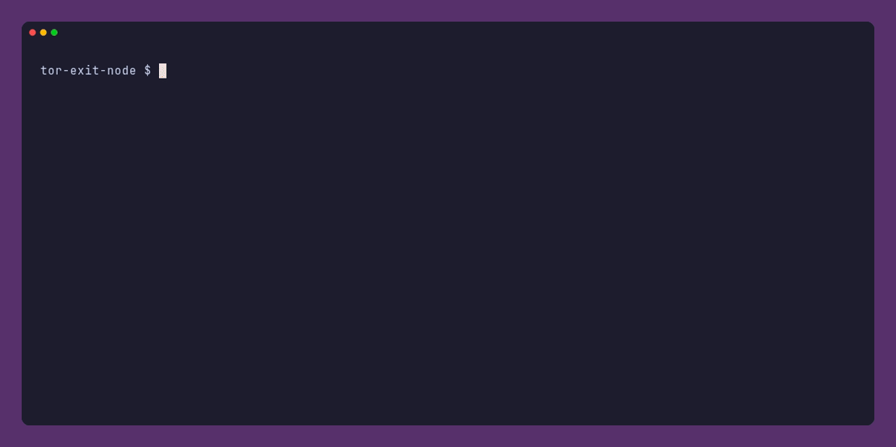
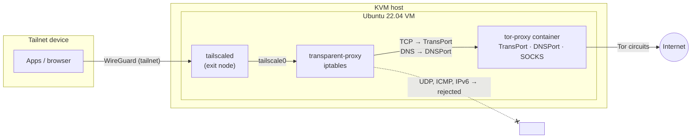

<div align="center">

# Tailscale Tor Exit Node

**Send any device in your tailnet through Tor with one tap. No Tor Browser, no proxy settings.**

[](LICENSE)
[](terraform/)
[](ansible/)
[](https://www.torproject.org)
[](https://tailscale.com/kb/1103/exit-nodes)



</div>

Pick this machine as the exit node on a laptop, phone or tablet, and that device's TCP traffic and DNS leave the internet from a Tor exit. One command provisions a hardened Ubuntu VM on a KVM host, runs Tor in a locked-down container, and installs a transparent-proxy firewall that **fails closed**: if Tor is down, traffic stops. It never falls back to your real IP.

## Highlights

- **Transparent.** Every app on the device uses Tor, including ones with no proxy support.
- **Leak-resistant.** Client TCP goes to Tor's TransPort and all DNS to its DNSPort. UDP, ICMP and IPv6 are rejected instead of forwarded.
- **Fails closed.** A stopped or broken Tor means no traffic and no DNS, never cleartext.
- **Self-healing.** A watchdog restarts a stalled Tor and restores firewall rules. Repairs take the node offline first.
- **Hardened.** Key-only SSH, UFW, fail2ban, automatic security updates. Tor runs non-root with a read-only filesystem and no capabilities.
- **One command, verifiable.** `make deploy` builds everything; `make verify` proves it, from bootstrap to leak checks.

## Quick start

**Prerequisites:** a Linux x86_64 host with KVM and libvirt, Terraform, Ansible, and a [Tailscale auth key](https://login.tailscale.com/admin/settings/keys). See [Requirements](#requirements).

```bash
git clone https://github.com/metharda/tor-exit-node.git
cd tor-exit-node
make check-deps   # confirms the host is ready
make deploy       # asks for VM settings and the auth key, then builds everything
```

`make deploy` creates the VM with Terraform, configures it with Ansible, and finishes by running the health and leak check. Expect around 10 minutes on the first run, most of it package installs and Tor's first bootstrap. Then:

1. **Approve the exit node** in the [Tailscale admin console](https://login.tailscale.com/admin/machines): open the machine's **⋯** menu, choose *Edit route settings*, and tick *Use as exit node*. Skip this if your ACL `autoApprovers` already approve it.
2. **Use it** from any device, through the exit-node menu in the Tailscale app or the CLI:

   ```bash
   tailscale set --exit-node=tailscale-tor-exit
   curl https://check.torproject.org/api/ip    # {"IsTor":true,"IP":"<a Tor exit>"}
   ```

3. **Stop using it:** `tailscale set --exit-node=`

> [!IMPORTANT]
> Keep **Use Tailscale DNS** enabled on your devices. It is on by default; the CLI equivalent is `tailscale set --accept-dns=true`. Tailscale then hands the device's DNS to the exit node, which answers it through Tor. With it off, the device asks its own resolver, outside the exit node.

## How it works



1. A device selects the VM as its exit node, so its internet traffic arrives on the VM's `tailscale0` interface.
2. The `transparent-proxy` rules redirect every TCP connection to Tor's **TransPort** and every DNS query to Tor's **DNSPort**, whatever server the query was addressed to. The VM's own DNS is redirected too, because Tailscale answers an exit-node client's DNS with the exit node's resolver.
3. Tor runs as a pure client in a container that shares the VM's network namespace (`network_mode: host`). Transparent proxying needs that: Tor reads each connection's original destination from the kernel's NAT table, and that information only exists in the namespace where the redirect happened.
4. Anything Tor cannot carry (UDP other than DNS, ICMP, IPv6) is rejected rather than forwarded, so it can't leak your real IP. Browsers fall back from QUIC to TCP automatically.

> [!NOTE]
> The VM's own traffic other than DNS goes direct, not through Tor. That covers tailscaled's control and DERP connections, package updates and NTP time sync. tailscaled must reach Tailscale directly, and Tor stops working if the clock drifts. None of this traffic carries client data.

<details>
<summary><b>Original system design sketch</b></summary>


</details>

## Security model

<div align="center">

</div>

- **Fails closed.** If the Tor container is down, redirected connections are refused and DNS gets no answer, as shown above. `systemctl stop transparent-proxy` removes the redirects but keeps the forward guard, so client traffic is dropped, not forwarded.
- **No routing around Tor.** tailscaled adds no NAT or forward rules (`--netfilter-mode=off`). The `TOR_FORWARD` chain rejects anything a client sends that wasn't redirected, and UFW's routed policy is `deny`.
- **No DNS leaks.** All UDP/53 from clients and from the VM goes to Tor's DNSPort. DNS over TCP from the VM is blocked, since the UDP-only DNSPort can't carry it. tailscaled doesn't manage the VM's resolver (`--accept-dns=false`), so tailnet DNS settings such as a DoH provider can't bypass Tor on the exit node.
- **Tor listeners are private.** TransPort, DNSPort and SOCKS accept connections only from loopback and `tailscale0` (`TOR_INPUT` chain plus UFW).
- **Self-healing.** Docker restarts the container if it exits. Every two minutes, `tor-watchdog.timer` restarts it if its health check reports a stalled bootstrap, and reinstalls the firewall rules if something removed them.
- **Repairs fail closed.** A broken Tor also means no DNS for repairs. When `make configure` finds Tor unhealthy, it first takes the node off the tailnet (`tailscale down`), then lets the VM resolve directly while it rebuilds Tor. The exit node only comes back once Tor is healthy and the redirects are in place.
- **Secrets stay out of the VM image.** The Tailscale auth key is passed to Ansible through the environment, used once with logging disabled, and never written to cloud-init, the inventory or disk.

> [!WARNING]
> **This is not Tor Browser.** It hides your IP address, not your identity. Cookies, logins and your browser's fingerprint still identify you to the sites you visit. Use [Tor Browser](https://www.torproject.org/download/) when you need strong anonymity.

## Requirements

| | |
| --- | --- |
| **KVM host** | Linux on x86_64 with hardware virtualization (`/dev/kvm`) and libvirt (`qemu:///system`). The VM uses 2 GB RAM, 2 vCPUs and 20 GB of disk by default. Tested on Debian 13. |
| **Tools** | Terraform ≥ 1.3, Ansible (ansible-core ≥ 2.15 with `community.general` and `ansible.posix`; the `ansible` pip package includes both), OpenSSH client, `xsltproc`. For `make lint`: `shellcheck` and `ansible-lint`. |
| **Tailscale** | An account and an [auth key](https://login.tailscale.com/admin/settings/keys). A reusable key is handy for retries. A tag such as `tag:exit-node` is optional. |

```bash
sudo apt install qemu-kvm libvirt-daemon-system libvirt-clients xsltproc
sudo usermod -aG libvirt "$USER"   # log out and back in, or run as root
```

The tools can run on the KVM host or on any machine that can reach its libvirt and the VM network.

> [!TIP]
> Use a **non-ephemeral** auth key for a permanent exit node. Ephemeral nodes are removed from the tailnet some time after going offline, so the node would vanish after a longer outage. Ephemeral keys are fine for throwaway test deployments.

## Configuration

Every `make deploy` prompt can be preset through the environment for unattended runs:

| Variable | Default | Meaning |
| --- | --- | --- |
| `VM_NAME` | `tailscale-tor-exit` | VM, libvirt pool/network prefix and Tailscale hostname |
| `VM_USERNAME` | `ubuntu` | Admin user in the VM |
| `VM_PASSWORD` | *(required)* | Console password, at least 8 characters (SSH is key-only) |
| `VM_MEMORY_MB` | `2048` | Memory |
| `VM_VCPUS` | `2` | vCPUs |
| `VM_DISK_GB` | `20` | Disk size |
| `TS_AUTHKEY` | *(first run only)* | Tailscale auth key |

```bash
VM_PASSWORD='…' TS_AUTHKEY='tskey-auth-…' VM_NAME=tor-exit make deploy
```

<details>
<summary><b>Advanced Terraform settings</b></summary>

Override with `TF_VAR_<name>`:

| Variable | Default | Meaning |
| --- | --- | --- |
| `network_cidr` | `192.168.100.0/24` | Private NAT network of the VM. Change it if the subnet is already used on the host. |
| `pool_path` | `/var/lib/libvirt/images` | Directory in which the VM's storage pool is created |
| `libvirt_uri` | `qemu:///system` | libvirt connection |

</details>

## Commands

| Command | What it does |
| --- | --- |
| `make deploy` | Create and configure the VM |
| `make verify` | Full health and leak check on the VM (see the GIF at the top) |
| `make status` | Terraform outputs, container and firewall state, `tailscale status` |
| `make logs` | Recent Tor log, plus watchdog and transparent-proxy journal entries |
| `make ssh` | Shell on the VM |
| `make configure` | Re-apply the configuration, e.g. after changing a role. Idempotent; no auth key needed once joined. |
| `make destroy` | Delete the VM, its disk, pool and network. Asks you to type the VM name; `CONFIRM=<name>` skips the prompt. |
| `make lint` | shellcheck, `terraform validate`/`fmt`, ansible-lint |

<details>
<summary><b>Checking from a client</b></summary>

With the exit node selected on a device:

```bash
curl https://check.torproject.org/api/ip           # "IsTor": true
curl https://icanhazip.com                         # a Tor exit IP, never yours
tailscale dns query example.com                    # resolver: http://<exit-node-ip>:<port>/dns-query
ping -c1 1.1.1.1                                   # fails: Tor does not carry ICMP
curl -6 https://icanhazip.com                      # fails: IPv6 is blocked
```

</details>

<details>
<summary><b>Monitoring (optional)</b></summary>

Monitoring is off by default. To enable it:

```bash
cd ansible && ansible-playbook playbook.yml -e monitoring_enabled=true
```

This installs `node_exporter` on `:9100`, reachable only over the tailnet. It also publishes `tor_bootstrapped`, `tailscale_running` and `transparent_proxy_rules_present` through the textfile collector, refreshed every minute.

</details>

## Limitations

- **TCP and DNS only.** UDP applications (games, VoIP, some video calls) don't work while the exit node is selected.
- **Tor speed.** Some sites block Tor exits or show them CAPTCHAs.
- **IPv4 only.** IPv6 is disabled on the VM.
- **Secrets on the deploying machine.** Terraform state (`terraform/terraform.tfstate`) holds the VM password and the SSH private key. Keep the checkout private; both files are git-ignored.

## Troubleshooting

<details>
<summary><b>Show common problems and fixes</b></summary>

| Symptom | Check / fix |
| --- | --- |
| *Cannot reach qemu:///system* or permission denied | Run as root, or add your user to the `libvirt` group and log in again. |
| Terraform: *network … overlaps*, or the VM gets no IP | `192.168.100.0/24` is in use on the host. Redeploy with `TF_VAR_network_cidr=192.168.150.0/24`. |
| Ansible fails at *Wait until the container health check passes* | Tor couldn't bootstrap; the task prints Tor's log. Common causes: no outbound internet from the VM, a wrong clock, or a network that blocks Tor (bridges are not configured). Fix it, then `make configure`. |
| *This node has not joined the tailnet yet* | Export `TS_AUTHKEY` and run `make configure`. |
| A device can't pick the exit node | Approve it in the admin console (see [Quick start](#quick-start)) and make sure your ACLs let the device use exit nodes (`autogroup:internet`). |
| Exit node works, but names don't resolve on a device | Enable *Use Tailscale DNS* on that device, then check `tailscale dns query example.com`. The resolver should be `http://<exit-node-ip>:<port>/dns-query`. |
| Exit node selected, but nothing loads | `make verify`. If Tor is unhealthy, `make logs`. The watchdog restarts it within minutes, or run `make ssh` and then `sudo docker restart tor-proxy`. |
| Tor container deleted or its image broken | `make configure` switches to maintenance mode (exit node offline), rebuilds Tor and brings the node back. |
| Pages load, but slowly | That's Tor. `sudo docker restart tor-proxy` builds fresh circuits. |
| Want to inspect the rules | `make ssh`, then `sudo iptables -t nat -L TOR_CLIENTS -nv` and `sudo iptables -L TOR_FORWARD -nv`. |
| Locked out of SSH | `sudo virsh console <vm-name>` on the KVM host, and log in with the VM password. |

</details>

## Development

<details>
<summary><b>Repository layout</b></summary>

```text
.
├── Makefile                  entry point (make help)
├── terraform/                libvirt VM: storage pool, NAT network, cloud-init, disk
├── ansible/
│   ├── playbook.yml
│   └── roles/
│       ├── system-hardening/ SSH, UFW, fail2ban, sysctl
│       ├── docker/           Docker Engine and Compose v2
│       ├── tor-container/    Tor image, compose file, watchdog
│       ├── networking/       transparent-proxy firewall, tor-exit-check
│       ├── tailscale/        exit-node login
│       └── monitoring/       optional node_exporter
├── scripts/                  deploy, destroy, check-dependencies
└── docs/demo/                VHS tapes and the GIFs they render
```

</details>

- Change a role, then run `make configure` against a deployed VM. Every role is idempotent.
- `make lint` must pass: shellcheck, `terraform validate`, `terraform fmt -check` and ansible-lint (production profile).
- `tor-exit-check` on the VM is the end-to-end acceptance test. Ansible runs it at the end of every play, and `make verify` runs it on demand.
- The GIFs are rendered from real sessions by [VHS](https://github.com/charmbracelet/vhs). To regenerate them, run `vhs docs/demo/verify.tape` and `vhs docs/demo/fail-closed.tape` from the repo root on the KVM host, with a deployed VM. The second tape briefly stops Tor on the VM.

## License

[MIT](LICENSE)
