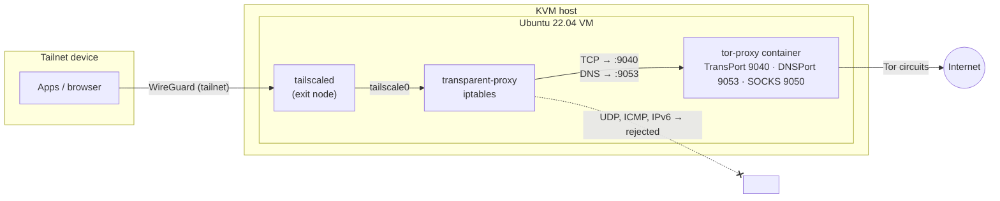

# Tailscale Tor Exit Node

Run a [Tailscale](https://tailscale.com) exit node that sends everything you browse through [Tor](https://www.torproject.org). Pick it as the exit node on any device in your tailnet (laptop, phone, tablet) and that device's TCP traffic and DNS leave the internet from a Tor exit. No Tor Browser, proxy settings or per-app configuration needed.

One command provisions a hardened Ubuntu VM on a KVM host, runs Tor in a locked-down container, and installs a transparent-proxy firewall that fails closed. If Tor is down, client traffic stops; it is never sent out unanonymised.


## How it works



1. A device selects the VM as its exit node, so its internet traffic arrives on the VM's `tailscale0` interface.
2. The `transparent-proxy` rules redirect every TCP connection to Tor's **TransPort** and every DNS query to Tor's **DNSPort**. The VM's own DNS is redirected as well, because Tailscale answers an exit-node client's DNS using the exit node's resolver.
3. Tor runs as a pure client in a container that shares the VM's network namespace (`network_mode: host`). That is required for transparent proxying: Tor reads each connection's original destination from the kernel's NAT table, and that information only exists in the namespace where the redirect happened.
4. Anything Tor cannot carry (UDP other than DNS, ICMP, IPv6) is rejected rather than forwarded, so it can't leak your real IP. Browsers fall back from QUIC to TCP automatically.

The VM's own traffic other than DNS (tailscaled's control and DERP connections, package updates, NTP time sync) is deliberately **not** sent through Tor. tailscaled must reach Tailscale directly, and Tor stops working if the clock drifts. None of this traffic carries client data, and the VM's DNS still goes through Tor.

### Components

| Path | Responsibility |
| --- | --- |
| `terraform/` | Creates the VM on libvirt: a dedicated storage pool, a private NAT network (`192.168.100.0/24`), an Ubuntu 22.04 cloud image, a cloud-init user and an SSH key. It also renders the Ansible inventory. |
| `ansible/roles/system-hardening` | Key-only SSH, UFW (deny incoming; allow SSH, Tailscale and the tailnet), fail2ban, unattended security upgrades, IPv6 disabled, kernel network hardening. |
| `ansible/roles/docker` | Docker Engine and Compose v2 from Ubuntu, log rotation, `no-new-privileges`. |
| `ansible/roles/tor-container` | Builds and starts the Tor container (Alpine, non-root, read-only rootfs, all capabilities dropped). Waits for a full bootstrap and installs the watchdog timer. |
| `ansible/roles/tailscale` | Installs Tailscale and joins the tailnet as an exit node, with `--netfilter-mode=off` and `--accept-dns=false`. |
| `ansible/roles/networking` | Installs `transparent-proxy` (iptables rules plus a systemd unit) and the `tor-exit-check` health check. |
| `ansible/roles/monitoring` | Optional Prometheus `node_exporter` with Tor metrics, reachable over the tailnet only. |
| `scripts/` | `deploy.sh`, `destroy.sh` and `check-dependencies.sh`, all driven by the `Makefile`. |

### Safety properties

- **Fails closed.** If the Tor container is down, redirected connections are refused and DNS gets no answer. `systemctl stop transparent-proxy` removes the redirects but keeps the forward guard, so client traffic is dropped, not forwarded.
- **No routing around Tor.** tailscaled adds no NAT or forward rules (`--netfilter-mode=off`). The `TOR_FORWARD` chain rejects anything a client sends that wasn't redirected, and UFW's routed policy is `deny`.
- **No DNS leaks.** All UDP/53 from clients and from the VM goes to Tor's DNSPort. DNS over TCP from the VM is blocked, since it can't be carried by the UDP-only DNSPort.
- **Tor listeners are private.** TransPort, DNSPort and SOCKS accept connections only from loopback and `tailscale0` (`TOR_INPUT` chain plus UFW).
- **Self-healing.** Docker restarts the container if it exits. Every two minutes, `tor-watchdog.timer` restarts it if its health check reports a stalled bootstrap and reinstalls the firewall rules if something removed them.
- **Secrets stay out of the VM image.** The Tailscale auth key is passed to Ansible through the environment, used once with logging disabled, and never written to cloud-init, the inventory or disk.

## Requirements

**KVM host.** Linux on x86_64 with hardware virtualization (`/dev/kvm`) and libvirt (`qemu:///system`). Plan for 2 GB RAM, 2 vCPUs and 20 GB of disk for the VM by default. Tested on Debian 13.

```bash
sudo apt install qemu-kvm libvirt-daemon-system libvirt-clients xsltproc
sudo usermod -aG libvirt "$USER"   # log out and back in, or run as root
```

**Tools**, either on the KVM host or on a machine that can reach its libvirt and the VM network:

- Terraform 1.3 or later
- Ansible (ansible-core 2.15 or later with the `community.general` and `ansible.posix` collections; the `ansible` pip package includes both)
- An OpenSSH client
- Optionally, for `make lint`: `shellcheck` and `ansible-lint`

```bash
make check-deps   # verifies all of the above
```

**Tailscale.** A Tailscale account and an [auth key](https://login.tailscale.com/admin/settings/keys). A reusable key is convenient for retries. Don't use an ephemeral key for a permanent exit node: ephemeral nodes are removed from the tailnet some time after going offline, so the node would vanish after a longer outage. Ephemeral keys are fine for throwaway test deployments. A tag such as `tag:exit-node` is optional.

## Quick start

```bash
git clone https://github.com/metharda/tor-exit-node.git
cd tor-exit-node
make deploy
```

`make deploy` asks for the VM name, user, size, a console password and the Tailscale auth key. It then:

1. creates the VM with Terraform (the first run downloads the Ubuntu cloud image),
2. configures it with Ansible (about 10 minutes; Tor's first bootstrap takes 1–3 minutes of that), and
3. finishes by running `tor-exit-check` on the VM.

Then:

1. **Approve the exit node** in the [Tailscale admin console](https://login.tailscale.com/admin/machines): open the machine's menu, choose *Edit route settings*, and tick *Use as exit node*. Skip this if your ACL `autoApprovers` already cover it.
2. **Use it** from any device: choose it in the Tailscale app's exit-node menu, or run

   ```bash
   tailscale set --exit-node=tailscale-tor-exit
   curl https://check.torproject.org/api/ip      # {"IsTor":true,"IP":"<tor exit>"}
   ```

3. **Stop using it:** `tailscale set --exit-node=`

### Unattended deploy

Every prompt can be preset through the environment:

| Variable | Default | Meaning |
| --- | --- | --- |
| `VM_NAME` | `tailscale-tor-exit` | VM, libvirt pool/network prefix and Tailscale hostname |
| `VM_USERNAME` | `ubuntu` | Admin user in the VM |
| `VM_PASSWORD` | *(required)* | Console password, at least 8 characters (SSH is key-only) |
| `VM_MEMORY_MB` | `2048` | Memory |
| `VM_VCPUS` | `2` | vCPUs |
| `VM_DISK_GB` | `20` | Disk size |
| `TS_AUTHKEY` | *(required on the first run)* | Tailscale auth key |

```bash
VM_PASSWORD='…' TS_AUTHKEY='tskey-auth-…' VM_NAME=tor-exit make deploy
```

Less common Terraform settings can be overridden with `TF_VAR_*`: `pool_path` (default `/var/lib/libvirt/images`), `network_cidr` (default `192.168.100.0/24`; change it if that subnet is in use on the host) and `libvirt_uri`.

## Day-to-day commands

| Command | What it does |
| --- | --- |
| `make verify` | Runs the full health and leak check on the VM (below) |
| `make status` | Terraform outputs, container state, firewall state, `tailscale status` |
| `make logs` | Recent Tor log, plus watchdog and transparent-proxy journal entries |
| `make ssh` | Shell on the VM |
| `make configure` | Re-applies the Ansible configuration, e.g. after changing a role (idempotent; no auth key needed once joined) |
| `make destroy` | Deletes the VM, its disk, pool and network (asks you to type the VM name; set `CONFIRM=<name>` to skip) |
| `make lint` | shellcheck, `terraform validate`/`fmt`, ansible-lint |

`make verify` prints something like:

```text
Tor
  PASS  tor-proxy container is bootstrapped (health: healthy)
  PASS  check.torproject.org confirms Tor (exit IP 185.220.101.4)

Transparent proxy
  PASS  iptables redirects and leak guards are installed
  PASS  DNS sent to any server is answered by Tor
  PASS  the system resolver works through Tor
  PASS  DNS over TCP cannot bypass Tor
  PASS  IPv6 is disabled

Tailscale
  PASS  connected to the tailnet as tailscale-tor-exit.tail1234.ts.net (100.101.102.103)
  PASS  exit node is advertised
  PASS  tailscaled leaves iptables to the transparent proxy
  PASS  tailscaled does not manage the system resolver
  WARN  exit node is not approved yet: https://login.tailscale.com/admin/machines

All checks passed, 1 warning(s)
```

### Checking from a client

With the exit node selected on a device:

```bash
curl https://check.torproject.org/api/ip           # IsTor: true
for i in 1 2 3; do curl -s https://icanhazip.com; done   # Tor exit IPs, never yours
dig example.com                                    # resolves (through Tor)
ping -c1 1.1.1.1                                   # fails: ICMP is not carried by Tor
curl -6 https://icanhazip.com                      # fails: IPv6 is blocked
```

For browser-level checks (WebRTC, fingerprinting), keep in mind that this hides your IP address, not your browser identity. See [Limitations](#limitations).

## Monitoring (optional)

Monitoring is off by default. To enable it:

```bash
cd ansible && ansible-playbook playbook.yml -e monitoring_enabled=true
```

This installs `node_exporter` on `:9100` (reachable only over the tailnet). It also publishes `tor_bootstrapped`, `tailscale_running` and `transparent_proxy_rules_present` through the textfile collector, refreshed every minute.

## Limitations

- **Not Tor Browser.** Traffic is anonymised at the network level only. Your browser's cookies, logins and fingerprint still identify you to the sites you visit. Use Tor Browser when you need strong anonymity.
- **TCP and DNS only.** UDP applications (games, VoIP, some video calls) do not work while the exit node is selected.
- **Some sites block Tor**, or show CAPTCHAs to Tor exits.
- **Speed** is Tor speed.
- **IPv4 only.** IPv6 is disabled on the VM.
- **Secrets on the deploying machine.** Terraform state (`terraform/terraform.tfstate`) contains the VM password and the SSH private key. Keep the checkout private. Both files are git-ignored.

## Troubleshooting

| Symptom | Check / fix |
| --- | --- |
| `make deploy`: *Cannot reach qemu:///system* or permission denied | Run as root, or add your user to the `libvirt` group and log in again. |
| Terraform: *network … overlaps* or the VM gets no IP | `192.168.100.0/24` is already in use on the host. Redeploy with `TF_VAR_network_cidr=192.168.150.0/24`. |
| Ansible fails at *Wait until the container health check passes* | Tor couldn't bootstrap; the task prints Tor's log. Common causes are no outbound internet from the VM, a wrong VM clock, or a network that blocks Tor (bridges are not configured). Fix the cause, then `make configure`. |
| *This node has not joined the tailnet yet* | Export `TS_AUTHKEY` and run `make configure`. |
| The device can't pick the exit node | Approve it in the admin console (see Quick start) and make sure your ACLs let the device use exit nodes (`autogroup:internet`). |
| Exit node selected but nothing loads | `make verify`. If Tor shows unhealthy, `make logs`. The watchdog restarts it within a few minutes, or run `make ssh` and then `sudo docker restart tor-proxy`. |
| Pages load but slowly | That's Tor. `sudo docker restart tor-proxy` builds fresh circuits. |
| Need to inspect the rules | `make ssh`, then `sudo iptables -t nat -L TOR_CLIENTS -nv` and `sudo iptables -L TOR_FORWARD -nv`. |
| Locked out of SSH | `sudo virsh console <vm-name>` on the KVM host and log in with the VM password. |

## Development

- Change roles, then `make configure` against a deployed VM. Every role is idempotent.
- `make lint` must pass: shellcheck, `terraform validate`, `terraform fmt -check` and ansible-lint (production profile).
- `tor-exit-check` on the VM is the end-to-end acceptance test, and Ansible runs it at the end of every play.

## License

MIT. See [LICENSE](LICENSE).
