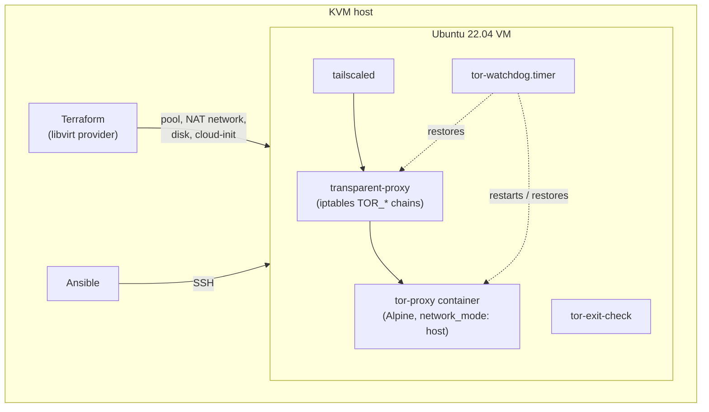

# Architecture

How the exit node is built, how a client's traffic gets into Tor, and why it is built this way. For the threat model see [security.md](security.md); for running it day to day see [operations.md](operations.md).

## Components



| Layer | Implemented in | What it does |
| --- | --- | --- |
| Provisioning | `terraform/` | Dedicated libvirt storage pool and NAT network per VM, Ubuntu 22.04 cloud image with a qcow2 overlay disk, a minimal cloud-init (admin user, SSH key, console password), an ED25519 SSH key, and the Ansible inventory. |
| Base system | `ansible/roles/system-hardening` | Key-only SSH, UFW, fail2ban, unattended security upgrades, IPv6 disabled, kernel network hardening. |
| Runtime | `ansible/roles/docker` | Docker Engine and Compose v2 from Ubuntu, with log rotation and `no-new-privileges`. |
| Tor | `ansible/roles/tor-container` | Builds and runs the Tor client container, waits for a full bootstrap, installs the watchdog. |
| Routing | `ansible/roles/networking` | The `transparent-proxy` firewall service and the `tor-exit-check` health check. |
| Tailnet | `ansible/roles/tailscale` | Joins the tailnet and advertises the exit node. |
| Metrics (optional) | `ansible/roles/monitoring` | `node_exporter` with Tor metrics. |

## Traffic path

A device that selects the exit node sends all of its internet traffic over WireGuard to the VM, where it arrives on `tailscale0`:

| Client traffic | What happens | Ends up at |
| --- | --- | --- |
| TCP to the internet | `TOR_CLIENTS` redirects it to `:9040` | Tor **TransPort**, which opens the connection from a Tor exit |
| DNS (UDP 53), to any server | `TOR_CLIENTS` redirects it to `:9053` | Tor **DNSPort** |
| DNS through MagicDNS (the default) | Tailscale sends it to the exit node's peer API; tailscaled resolves it with the VM's resolver, whose UDP 53 is redirected to `127.0.0.1:9054` | Tor **DNSPort** (loopback listener) |
| TCP to the VM itself or to tailnet peers | Not redirected | SSH, peer API |
| UDP (other than DNS), ICMP | Not redirected, so it would be forwarded; `TOR_FORWARD` rejects it | Dropped with an error to the client |
| IPv6 | IPv6 is disabled on the VM; `ip6tables` drops anything forwarded from `tailscale0` | Dropped |

Tor's TransPort learns where a redirected connection was going by asking the kernel's connection tracking for the original destination. That information only exists in the network namespace where the redirect happened, so the Tor container shares the VM's namespace (`network_mode: host`). With a separate Docker network, Tor would only ever see its own address.

## Tor configuration

`ansible/roles/tor-container/files/torrc`:

| Listener | Address | Used by |
| --- | --- | --- |
| TransPort | `0.0.0.0:9040` | Redirected client TCP |
| DNSPort | `0.0.0.0:9053` | Redirected client DNS |
| DNSPort | `127.0.0.1:9054` | The VM's own DNS. A UDP reply from a socket bound to `0.0.0.0` leaves from the interface address, which the kernel can't match to a query redirected to loopback, so this listener is bound to `127.0.0.1` explicitly. |
| SocksPort | `0.0.0.0:9050` | Explicit SOCKS use from the VM or the tailnet |
| ControlSocket | `/var/lib/tor/control.sock` | The container health check only |

- `ClientOnly 1`, `ORPort 0`, `DirPort 0`: a pure client that never relays traffic for others.
- `SocksPolicy` accepts loopback, the RFC 1918 ranges and the tailnet range (`100.64.0.0/10`). It also applies to DNSPort, and DNS redirected from the VM keeps the VM's private source address. The firewall already limits who can reach these ports.
- `VirtualAddrNetworkIPv4 10.192.0.0/10` with `AutomapHostsOnResolve 1` lets clients open `.onion` addresses: the name resolves to a virtual address that TransPort maps back.

The container runs as the non-root `tor` user with a read-only root filesystem, every Linux capability dropped and `no-new-privileges`. Its state lives in the `tor-data` volume. The health check reads `status/bootstrap-phase` over the control socket and only reports *healthy* at 100 %.

## Firewall

`/usr/local/sbin/transparent-proxy` (`ansible/roles/networking/files/transparent-proxy.sh`) installs everything in its own chains, jumped to from position 1 of the built-in chains. It never flushes tables that belong to Docker, UFW or tailscaled.

| Chain | Hooked from | Rules |
| --- | --- | --- |
| `TOR_CLIENTS` (nat) | `PREROUTING -i tailscale0` | UDP 53 → REDIRECT `:9053`; destination is the VM → RETURN; `100.64.0.0/10` → RETURN; TCP → REDIRECT `:9040` |
| `TOR_LOCAL_DNS` (nat) | `OUTPUT` | UDP 53 → REDIRECT `:9054` |
| `TOR_INPUT` (filter) | `INPUT` | From `lo` or `tailscale0` → RETURN; otherwise drop TCP 9040/9050 and UDP 9053 |
| `TOR_FORWARD` (filter) | `FORWARD` | Anything in from `tailscale0` → REJECT |
| `TOR_OUTPUT` (filter) | `OUTPUT` | TCP 53 not on `lo` → REJECT (TCP DNS can't be carried by DNSPort) |
| (ip6tables) | `FORWARD` | In from `tailscale0` → DROP |

`transparent-proxy start` is idempotent: it removes its own rules, then installs them again. `stop` removes only the two NAT chains and keeps the guards, so stopping the service blocks client traffic instead of letting it through. `status` exits non-zero if any hook is missing. The `transparent-proxy.service` unit runs `start` at boot, after UFW, Docker and tailscaled.

## Tailscale

The node joins with:

```text
tailscale up --reset --advertise-exit-node --netfilter-mode=off --accept-dns=false --hostname=<vm name>
```

- `--netfilter-mode=off`: tailscaled adds no iptables rules of its own. Its default forward and NAT rules would let client traffic around the proxy.
- `--accept-dns=false`: tailscaled leaves the VM's resolver alone. It still answers exit-node clients' DNS, through the VM's resolver and therefore through Tor. With it on, tailnet DNS settings would apply on the exit node too; a DNS-over-HTTPS provider, for example, would be queried directly instead of through Tor.
- The auth key is only used when the node hasn't joined yet; re-runs work without it.

`net.ipv4.ip_forward` is enabled because Tailscale expects it on an exit node, even though nothing is actually forwarded: every client packet is either redirected to a local port or rejected.

## Provisioning details

- **Disk attached by path.** On AppArmor hosts (Debian, Ubuntu), libvirt's per-VM profile helper runs without a libvirt connection and can't resolve disks attached as pool volumes. qemu would then be denied the disk and its backing image. The disk is therefore attached by file path, and `terraform/disk-driver.xsl` sets its driver type back to qcow2, because the provider declares file disks as raw.
- **Provider pin.** `dmacvicar/libvirt` is pinned to 0.8.x; 0.9 is a rewrite with an incompatible schema.
- **No secrets in cloud-init** except the console password. Tailscale is configured by Ansible.

## Configuration run

`ansible/playbook.yml` runs:

1. Wait for SSH and cloud-init, gather facts.
2. **Maintenance mode** if needed: when Tor is unhealthy and the firewall is active, take the node off the tailnet (`tailscale down`) and stop the redirects, so the VM can resolve names to repair itself while clients can't use the node.
3. Upgrade packages.
4. Roles: `system-hardening` → `docker` → `tor-container` (waits until Tor is bootstrapped) → `networking` (from here on the VM's DNS goes through Tor) → `tailscale` (last, so clients only reach the node once the redirects are in place) → `monitoring` (optional).
5. `tor-exit-check`; the play fails if a required check fails.

Every role is idempotent: a second run reports no changes and doesn't restart Tor.

## Design decisions

| Decision | Why |
| --- | --- |
| The VM's own traffic other than DNS goes direct | tailscaled must reach Tailscale directly, and Tor fails if the clock drifts (NTP). None of it carries client data. |
| The VM's own DNS goes through Tor | Tailscale answers exit-node clients' DNS with the exit node's resolver, so that resolver must use Tor. |
| Fail closed everywhere | Redirects without guards would leak whenever something stopped. |
| One Tor client for all devices | Tor isolates streams by client address by default (`IsolateClientAddr`), so different tailnet devices don't share circuits. |
| Watchdog as a systemd timer | Docker's restart policy doesn't act on failed health checks. |
